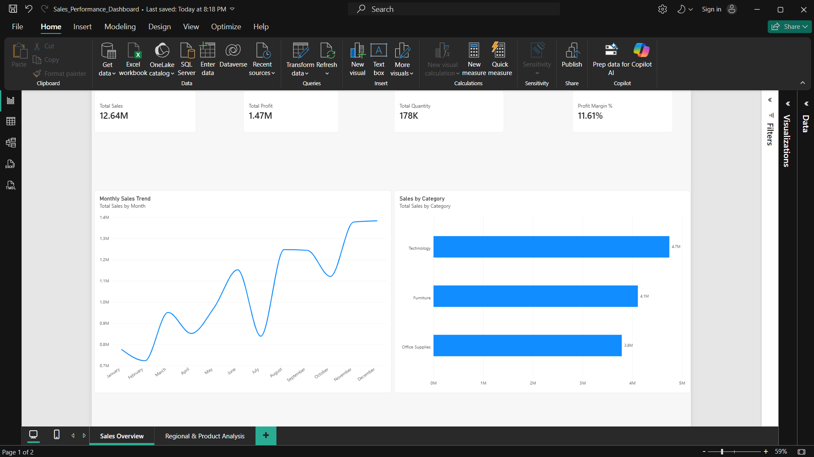
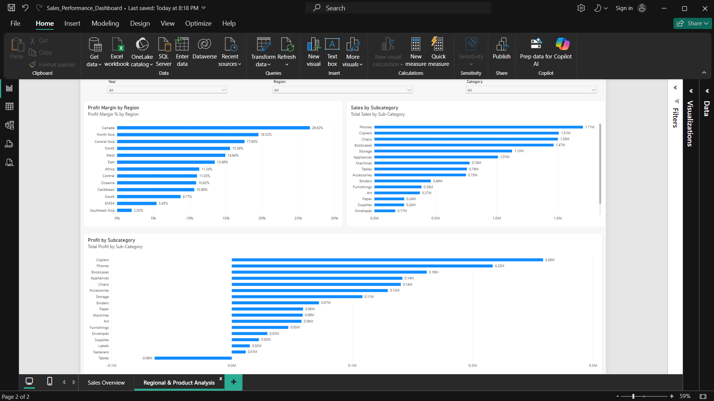

# Sales Data Analysis & Power BI Dashboard

An end-to-end data analytics project using **Python, Pandas, SQLite, SQL, and Power BI** to analyze sales trends, profitability, and product performance.

## Tools & Technologies
- Python & Pandas
- SQLite & SQL
- Power BI
- Matplotlib

## Dashboard

### Sales Overview


### Regional & Product Analysis


## Key Insights

- **Total Sales:** 12,642,501.91
- **Total Profit:** 1,467,457.29
- **Quantity Sold:** 178,312
- **Overall Profit Margin:** 11.61%
- **Top Sales Category:** Technology
- **Loss-Making Subcategory:** Tables, with a loss of approximately 64,083.39
- **Regional Opportunity:** Southeast Asia had a profit margin of 2.02%.

## Project Overview

Analyzed **51,290 sales records from 2011–2014** to evaluate sales performance, identify unprofitable products, and uncover regional business opportunities.

- Cleaned and validated data using Python and Pandas.
- Used SQL to analyze category, regional, and monthly performance.
- Built an interactive Power BI dashboard with KPI cards, charts, and filters.

## Project Structure

```text
Sales_Data_Analysis/
├── screenshots/
├── reports/
├── sql/
├── data/
├── Sales_Performance_Dashboard.pbix
├── data_cleaning.py
├── eda.py
├── load_sqlite.py
├── run_sql_analysis.py
└── requirements.txt
```

## How to Run

1. Clone the repository:
   ```bash
   git clone https://github.com/SAK2823/sales-data-analysis.git
   ```
2. Install dependencies:
   ```bash
   pip install -r requirements.txt
   ```
3. Ensure the required dataset is available at the path expected by the scripts.
4. Run the Python scripts from the project directory.
5. Open `Sales_Performance_Dashboard.pbix` in Power BI Desktop.

*Note: Financial figures are shown in the dataset's reported units.*
